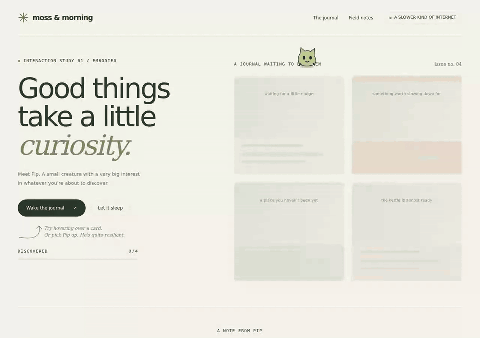
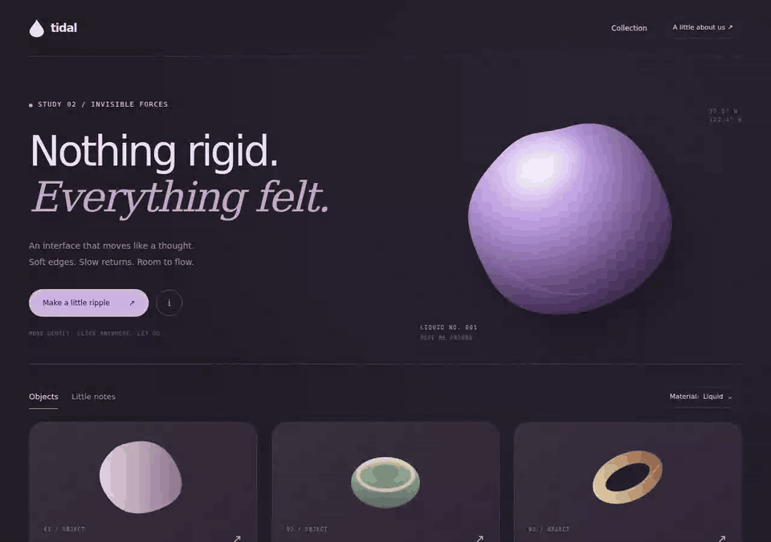
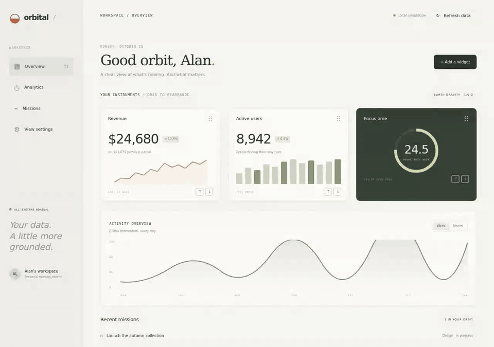
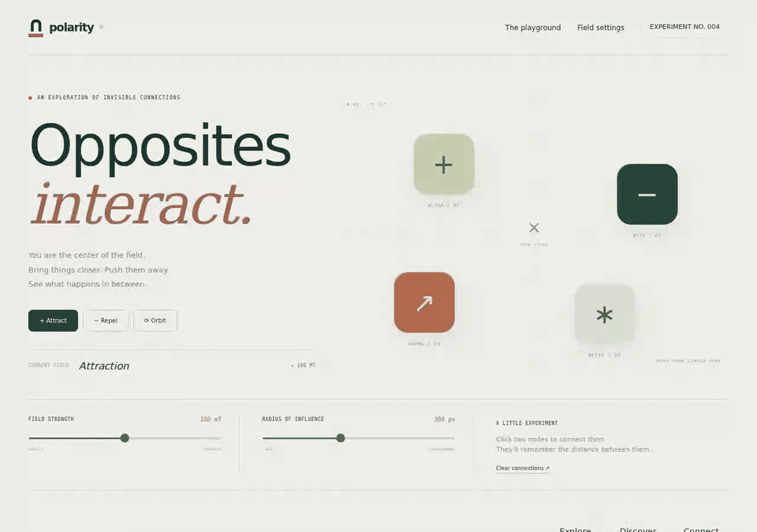
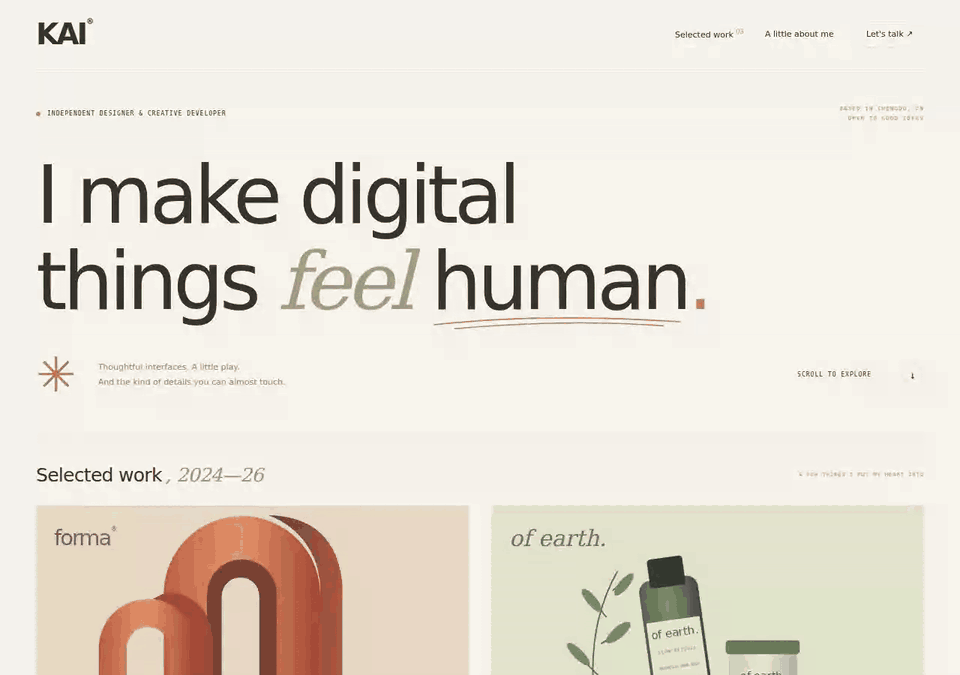
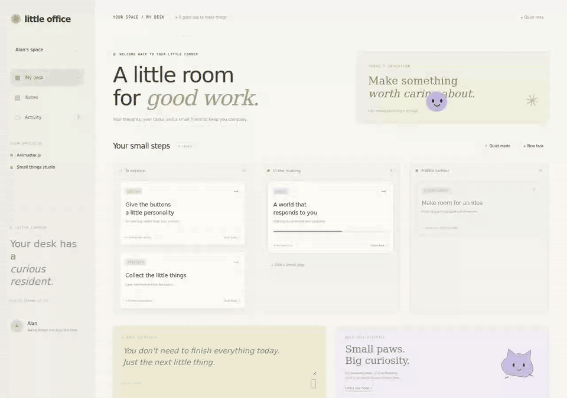

<div align="center">
<picture>
  <source media="(prefers-color-scheme: dark)" srcset="docs/assets/branding/logo-dark.svg">
  <source media="(prefers-color-scheme: light)" srcset="docs/assets/branding/logo-light.svg">
  
</picture>

**A Physics-Driven Interaction Framework for the Web**

One semantic protocol. One spatial world. Two ways to feel it.


[English](README.md) · [简体中文](README.zh-CN.md)

[Quick start](#quick-start) · [API docs](docs/API.md) · [Six demos](#six-interactive-demos) · [Publication preparation](docs/NPM-PUBLISHING.md)
</div>

## Introduction

Make existing interfaces respond with weight, curiosity and a little life. Animatter is an **independent, optional, framework-agnostic interaction runtime**. Keep your HTML, React or Vue application. Enhance a button, a region or a whole page; switch modes or remove the runtime without replacing your UI framework.

## Six Interactive Demos

Every scene is an independent HTML entry using the same core. These are **actual Chromium recordings**, converted to looping GIFs; full-resolution PNG captures and provenance are in [docs/assets/demos](docs/assets/demos). Links below are source entries to run locally, not deployed online demos.

| Skeleton Pet · Moss & Morning | Liquid World · Tidal |
| --- | --- |
| [](demos/skeleton-pet/index.html) | [](demos/liquid-world/index.html) |
| **Embodied + Field.** Pip wakes a sleeping journal, follows component anchors and can be picked up. Validates trajectory planning, contact feedback and interruption. [Open locally](http://localhost:4173/demos/skeleton-pet/index.html). | **Field.** Soft objects, drag release, ripples, material changes, tooltips and modal transitions. Validates spring-based softness and shared physical materials. [Open locally](http://localhost:4173/demos/liquid-world/index.html). |
| **Gravity Dashboard · Orbital** | **Magnetic Interface · Polarity** |
| [](demos/gravity-dashboard/index.html) | [](demos/magnetic-interface/index.html) |
| **Field.** Reorder instruments by dragging or keyboard-accessible buttons, refresh data and adjust gravity. Validates mass, collisions, constraints and continuous DOM layout. [Open locally](http://localhost:4173/demos/gravity-dashboard/index.html). | **Field.** Attraction, repulsion, orbital forces and connectable nodes. Validates pointer distance/speed, custom forces, distance constraints and cross-component effects. [Open locally](http://localhost:4173/demos/magnetic-interface/index.html). |
| **Physics Portfolio · KAI** | **Living Workspace · Little Office** |
| [](demos/physics-portfolio/index.html) | [](demos/living-workspace/index.html) |
| **Field.** A complete concept portfolio with tactile project cards, annotations, navigation, dialogs and a local-only contact form. Validates L0–L7 orchestration across a real page. [Open locally](http://localhost:4173/demos/physics-portfolio/index.html). | **Embodied + Field.** A usable task board, notes, success/error states and an autonomous companion. User actions preempt exploration; paused work resumes. Validates planning, scheduling and asynchronous results. [Open locally](http://localhost:4173/demos/living-workspace/index.html). |

## Why Animatter?

- **Opt in deliberately.** Register individual surfaces or scan an explicit selector. Region rules support mixed modes and quiet zones.
- **Share meaning and space.** Actors and fields consume the same events, anchors, graph, scheduler and physics state.
- **Preserve native behavior.** Forms, links, keyboard activation and touch scrolling remain browser-owned. Only explicitly draggable surfaces capture pointers.
- **Own what you change.** Teardown restores owned styles, removes render layers, cancels work and releases listeners/observers.
- **Extend the runtime.** Plug in behaviors, force fields, materials, surface/actor renderers and framework lifecycle adapters.

| Layer | Role | Animatter's relationship |
| --- | --- | --- |
| CSS / animation libraries | Animate properties and transitions | Animatter adds shared geometry, semantic events, physical constraints and behavior arbitration. |
| Component libraries | Supply widgets and accessibility patterns | Enhance their existing DOM; retain their keyboard and application behavior. |
| React / Vue / Web frameworks | Own rendering, state and routing | Optional lifecycle adapters; no replacement component tree or router. |

## Two Interaction Modes

**Embodied interaction** gives the interface a visible, procedural agent. Actors read current DOM anchors, plan jumps and side-climbing routes, react to pointer/focus/application state, blend actions and yield to the user. SVG and Canvas renderers are included. Characters are not fixed GIF playback.

**Field interaction** lets the page itself respond: springs, damping, inertia, attraction/repulsion, finite depth, drag traction/release, click impulses, ripples, soft deformation, presence transitions and layout feedback. Liquid is a spring-based soft-body approximation, not a fluid simulation.

Use `mode: 'field' | 'embodied' | 'both' | 'off'`. Combine global, regional and per-surface rules; `setEnabled(false)` restores effects without replacing native business controls.

## Features

| Level | Coverage |
| --- | --- |
| L0 | Pointer, hover, enter/leave, proximity |
| L1 | Tooltip, annotation, cursor, focus and micro-interactions |
| L2 | Click, double click, long press, drag and two-pointer gesture |
| L3 | Input, selection, copy, delete and expansion |
| L4 | Buttons, cards, forms, menus, lists and accordions |
| L5 | Scroll, layout, modals, overlays and viewport |
| L6 | Navigation, tabs, routing and page transitions |
| L7 | Loading, success, error, notifications and asynchronous state |

Native inputs are collected automatically inside the root. Application-specific state is explicitly bridged through `emit`, `track`, `transition` and `bind`; taxonomy names do not imply magical inference of arbitrary business logic. Combinations, priorities, FIFO queues, preemption, cancellation, resumption and latest-result-wins synchronization are implemented. See the [complete protocol and API](docs/API.md).

## Development Environment

| Category | Actual configuration and evidence |
| --- | --- |
| Runtime | Local Node.js **24.22.1** on Linux x64; no `engines` minimum is declared for the workspace or packages, and other Node versions are not certified |
| Package manager | npm **11.9.0**; `packageManager: npm@11.9.0`, lockfile and `npm ci` |
| Language | TypeScript **5.9.3**, strict mode, ES2022 target |
| Modules | TypeScript source; JavaScript ESM + `.d.ts` declarations; no dedicated CommonJS entry |
| Styling | Optional CSS, custom properties, individual translate/rotate/scale properties |
| Rendering | DOM surfaces, SVG / Canvas actors |
| Build | TypeScript project references (`tsc -b`) + esbuild **0.25.12** browser ESM bundle |
| Testing | Node.js built-in `node:test` + tsx **4.20.6**; ESLint **9.39.1** |
| Browser testing | Playwright **1.56.1**; recorded Linux Chromium **141.0.7390.37** |
| Integration | Vanilla JS; declared peers React `>=18`, Vue `>=3.3`; tested React **19.2.0**, Vue **3.5.44** |
| License | MIT |

Native browser APIs include Pointer Events, ResizeObserver, MutationObserver, matchMedia, requestAnimationFrame and AbortController. Core and adapter imports do not access the DOM and support server-side module loading; call `createWorld()` after client mount. A declared peer range is not a version-by-version test claim. Firefox/WebKit, Windows/macOS and physical iOS/Android devices have not passed this acceptance run; touch cases use browser emulation. See the [compatibility matrix](docs/PACKAGE-COMPATIBILITY.md).

## Installation

**No npm publication is claimed.** Build and generate current tarballs under `artifacts/packages/`. Archives in [releases/0.1.0](releases/0.1.0/) are historical and do not include this preparation work. Package-name checks returned public Registry 404 responses on 2026-10-31; namespace ownership is still unverified. This is not a reservation or a release.

```sh
git clone https://github.com/Alanshown/Animatter.js.git
cd Animatter.js
npm ci
npm run build
npm run dev
```

Open [the local gallery](http://localhost:4173). HTML entries need this HTTP server; file:// module loading is not supported. No Docker or external asset service is required.

To use the packages in another project:

```sh
npm run build
npm run verify:package
# In your consuming project, use the actual absolute path to this checkout:
npm install /path/to/Animatter.js/artifacts/packages/animatter-0.1.0.tgz
# Optional adapters, with the corresponding React/Vue peer installed:
npm install /path/to/Animatter.js/artifacts/packages/animatter-react-0.1.0.tgz
npm install /path/to/Animatter.js/artifacts/packages/animatter-vue-0.1.0.tgz
```

## Quick Start

A page at the checkout root, served by the local server:

```html
<link rel="stylesheet" href="/packages/core/dist/materials.css">
<button id="save" data-am="save" class="am-surface">Save</button>
<p id="status" role="status"></p>
<script type="module">
  import { createWorld } from '/packages/core/dist/animatter.js';
  const world = createWorld({ mode: 'field' });
  world.scan();
  document.querySelector('#save').addEventListener('click', () => {
    document.querySelector('#status').textContent = 'Saved';
    world.emit('success', 'save');
  });
  // On teardown: world.destroy();
</script>
```

For bundlers, import from `animatter` and optionally `animatter/materials.css`. Create worlds after client mount; importing the package itself is safe without a DOM.

## Framework Integrations

```tsx
import { useAnimatter, useSurface } from '@animatter/react';
import type { AnimatterWorld } from 'animatter';
const options = { id: 'save' };
function Save({ world }: { world: AnimatterWorld | null }) {
  const ref = useSurface<HTMLButtonElement>(world, options);
  return <button ref={ref}>Save</button>;
}
export function App() {
  const { ref, world } = useAnimatter({ mode: 'field' });
  return <div ref={ref}><Save world={world} /></div>;
}
```

```vue
<script setup lang="ts">
import { ref } from 'vue';
import { useAnimatter, useSurface } from '@animatter/vue';
const root = ref<HTMLElement | null>(null);
const button = ref<HTMLElement | null>(null);
const world = useAnimatter(root, { mode: 'field' });
useSurface(world, button, { id: 'save' });
</script>
<template><main ref="root"><button ref="button">Save</button></main></template>
```

Adapters handle mount/unmount, including tested React StrictMode cleanup. World options are captured on mount; use `configure`/`setMode` for live changes. Keep React surface options stable.

## Configuration and Materials

```ts
import { createWorld, materials, SVGActorRenderer, orbitalField } from 'animatter';
const world = createWorld({
  mode: 'both', material: materials.elastic,
  regions: [{ selector: '.quiet-zone', mode: 'off' }],
});
world.register(document.querySelector<HTMLElement>('#card')!, {
  id: 'card', draggable: true, collision: true,
  material: { mass: 1.4, stiffness: 85, damping: 11, softness: .8 },
});
const pip = world.addActor('pip', {
  renderer: new SVGActorRenderer('#bdca90'), idle: true, draggable: true,
});
await pip.moveTo('card', { kind: 'climb', priority: 80 });
const removeField = world.addField(orbitalField('orbit', 180, 340));
// Later: removeField(); world.destroy();
```

```css
.my-material {
  --am-mass: 1.4;
  --am-stiffness: 85;
  --am-damping: 11;
  --am-softness: .8;
  --am-max-displacement: 38;
}
```

Presets: **elastic, liquid, heavy, magnetic**. CSS values are read at registration; explicit JS settings win. Use `world.layout(() => reorderDOM())` for continuous reordering, and `world.invalidate()` after external position changes. Use a wrapper when your application also owns individual CSS translate/rotate/scale properties.

## API and Documentation

[API and extension protocols](docs/API.md) · [Architecture](docs/ARCHITECTURE.md) · [Core acceptance gate](docs/CORE-ACCEPTANCE.md) · [Verification report](docs/VERIFICATION.md) · [Measured evidence](docs/testing/) · [Roadmap](ROADMAP.md)

```sh
npm run typecheck
npm run lint
npm test
npm run build
npm run verify:package
npx playwright install chromium
npm run test:core-browser
npm run test:browser
npm run benchmark
npm run capture             # Requires ffmpeg + ffprobe
npm run check               # Full required local verification
```

`test:compat` additionally attempts Firefox/WebKit and requires their Playwright system dependencies. `capture` records the running pages and creates the six GIFs, desktop PNGs and a provenance manifest. Scene data, project identities and task results are local demonstration content; forms send nothing.

Publication engineering: [npm publishing](docs/NPM-PUBLISHING.md) · [package compatibility](docs/PACKAGE-COMPATIBILITY.md) · [release checklist](docs/RELEASE-CHECKLIST.md) · [current audit](docs/NPM-PREPARATION-AUDIT.md) · [brand guide](docs/assets/branding/BRANDING.md) · [changelog](CHANGELOG.md)

## Architecture

One TypeScript core shares events, spatial mapping, physics and behavior orchestration. The interaction graph and priority arbiter coordinate effects across components; actors and fields use the same world state. Adapters own lifecycle without duplicating the engine. See [architecture](docs/ARCHITECTURE.md).

## Testing and Compatibility

The repository includes pure unit tests, core integration fixtures, React/Vue lifecycle checks, Playwright scenarios for all six scenes, 390 px touch/1280 px reduced-motion/1440 px desktop checks, cancellation/conflict tests, layout continuity, mode/off controls, style restoration and resource cleanup. Raw results and measured bundle/physics/browser timings are committed in [docs/testing](docs/testing/). Measurements describe the recorded headless Linux host, not a universal FPS or device promise.

**Verified:** Chromium 141 on this Linux host. **Unverified:** Firefox page creation is blocked in this environment; WebKit lacks host libraries. Safari/iOS/Android devices have not been tested. No cross-browser pass is fabricated.

This is a lightweight UI solver: rectangular contacts, finite-depth planes, procedural kinematic actors and sampled obstacle clearance. It is not a general 3D rigid-body engine, true fluid solver or articulated character system. Dense collision piles can become expensive. Shadow DOM, arbitrarily transformed ancestors and automatic observation of every external style change are outside current guarantees. System reduced motion is respected by default; use native accessibility semantics and provide alternatives to drag-only actions.

## Roadmap

0.1.0 provides the shared runtime, both modes, adapters, extension protocols and six studies. Next: broader browser/device validation, richer renderer examples, worker/broadphase experiments and a stable 1.0 API. See [ROADMAP.md](ROADMAP.md).

**Publication gate: complete core architecture and L0–L7 interaction acceptance before publishing. Passing branding and packaging checks does not establish complete framework acceptance. This work does not publish npm packages, create a Release or increase versions. APIs may change during 0.x.**

## Contributing

Include reproducible evidence and preserve optional adoption, native behavior and teardown ownership. Read [CONTRIBUTING.md](CONTRIBUTING.md).

## License

Licensed under [MIT](LICENSE), including the original vector brand and lettering.
