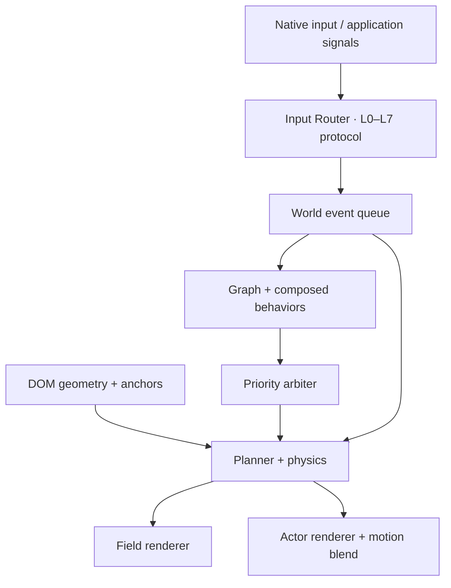

# Architecture

Animatter is an optional interaction enhancement layer. It does not own your component tree, router, form values, network requests or application state. A world owns only explicitly registered surfaces, its input subscriptions, simulation state and renderer artifacts.

## Packages and dependency direction

| Package | Responsibility | Runtime dependencies |
| --- | --- | --- |
| `animatter` | Independent TypeScript/JavaScript runtime, CSS tokens, render protocols, devtools | None |
| `@animatter/react` | Hooks with mount/unmount ownership | React peer, core peer |
| `@animatter/vue` | Composition functions with reactive ownership | Vue peer, core peer |

`world.ts` composes independently testable modules; the solver, scheduler, graph, planner, motion mixer and sequence helpers work without a DOM. Browser-only services are instantiated when creating a world, never during module import. This permits server-side module loading; create worlds after client mount.

## Time and coordinates

Input points, spatial rectangles, actor positions and debug proxies use CSS pixels in viewport coordinates. Z is a lightweight plane/depth abstraction, not a general 3D scene. Surfaces retain native layout; each physics body carries a displacement from its measured DOM origin. Fields write individual CSS translate/rotate/scale properties; they do not overwrite the CSS transform property. Use a wrapper if an application also owns those individual properties.

The clock clamps elapsed frame time to 50 ms and accumulates 1/120-second substeps. Springs use semi-implicit Euler. Mass, damping, gravity, restitution, screen-space AABB contacts, finite depth limits and distance constraints share one solver. Depth-separated bodies farther than 16 px do not collide. Collision broadphase is an x sweep; dense vertical piles can still approach quadratic work. This is UI physics, not a high-speed continuous rigid-body or full fluid solver.

## Geometry and layout

`SpatialRegistry` caches five anchors per surface and builds a uniform 240 px spatial grid after invalidation. ResizeObserver, subtree/class/hidden/open mutations, nested scroll and viewport changes invalidate geometry. The measurement pass removes only owned individual transforms temporarily and restores both value and `!important` priority. This avoids accumulating the runtime's own displacement in the next measured origin.

`world.layout(mutate)` captures visual positions, runs synchronous DOM layout changes, measures new origins and seeds a spring displacement so reorders remain continuous. Temporary motion limits allow displacements larger than the usual local field radius. For external inline position changes, CSS transforms, ancestor changes outside the root or stylesheet replacement, call `world.invalidate()` explicitly. Observing every style mutation would also observe every physics render and create feedback loops.

## Input and meaning

Native input is delegated inside the root. Pointer, hover, proximity, focus, click, double click, long press, drag, two-pointer gesture, input, selection, copy, delete, form, native details toggle, scroll, viewport and anchor navigation produce semantic signals. Role tabs and `data-am-kind="card|menu|list|accordion"` provide component meaning. Applications bridge router state, modals, tooltip visibility and asynchronous state through `emit`, `transition` and `track`. A taxonomy entry is a contract, not a claim that all application semantics can be inferred from arbitrary markup.

The runtime does not patch browser prototypes, router methods, fetch, input values or event preventDefault. Only opt-in draggable surfaces and actors receive `touch-action:none`/pointer capture. Their native business event handlers continue to execute. Non-draggable touch content retains native scrolling. Native keyboard activation remains the browser's responsibility; drag reordering should provide accessible buttons, as the dashboard does.

Events are delivered through a bounded synchronous queue. Nested graph effects enqueue events instead of recursively calling listeners. A 100-event bound detects feedback cycles and reports an error. Subscriber failures are isolated through `onError`.

## Arbitration and composition

Each arbiter channel has one active task and a stable priority queue. Higher numeric priority pauses the current task. Completing/cancelling it resumes the next task. AbortSignal cancellation detaches its listener and resolves the task as `cancelled`. Bulk cancellation never resumes intermediate tasks. Failed hooks release their entries; errors propagate to the runtime's error handler.

`bind` turns semantic event combinations into tasks, with target/condition filtering, a bounded combination window, priority and queue/replace policy. `sequence` combines frame-driven steps and asynchronous waits. Preemption pauses progression; a completed asynchronous wait is retained until the task resumes. Cancelling a task prevents later steps but cannot automatically abort a promise already created by application code. Pass an application AbortSignal to the underlying operation when needed.

`track` provides latest-result-wins synchronization per target. Superseded, aborted and destroyed work cannot emit stale success/error events. It returns/rethrows the original promise result and does not claim to cancel the network operation.

## Two render modes, one runtime

Field mode applies proximity-dependent spring targets, explicit force-field samples, click impulses, inertial drag release, scroll impulses, elastic scale deformation and ripples. Material tokens determine mass and response. Liquid is a spring/softness approximation; no Navier–Stokes claim is made.

Embodied mode consumes the same semantic stream and geometry. Actors plan trajectories from their current position to current surface anchors, sample obstacle clearance for jumps, replan moving targets and attach to the target after landing. Actor contacts impart impulses to component bodies. Walking, jumping, sliding, grabbing and climbing are configurable procedural trajectories; direct actor dragging uses pointer capture. `MotionMixer` keeps normalized action weights during interruption. User motion runs at priority 100, autonomous exploration at 10. A custom renderer receives pose, velocity, state, gaze and weights. SVG and Canvas are included.

Actors are kinematic agents with planned parabolic arcs, not articulated rigid-body creatures. The planner is a rectangular obstacle-clearance heuristic, not a navmesh or global shortest-path guarantee. It may route outside a crowded viewport. No promise of physically valid climbing around arbitrary complex/transformed geometry is made.

## Ownership and teardown

Each world owns an AbortController for DOM listeners, observers, animation clock, surfaces, task queues, force sources, binding disposers, plugins and a fixed actor portal. Portals are appended outside the root so transformed application ancestors do not change their coordinate system. They are scoped to their world and removed on destroy. Use one world per surface; two worlds must not write the same element's individual transforms.

Disabled/off worlds restore the original owned style values and stop effects. Destroy additionally disconnects observers, cancels frames and long-press timers, releases pointer capture, cancels tasks, disposes bindings/plugins, removes actor/devtools DOM, and clears caches/subscribers. Native application nodes and listeners are retained. Explicit `transition`/`layout` actions intentionally change application DOM state and are not rolled back on teardown.

System reduced motion disables field movement and idle exploration, snaps semantic actor reactions and completes presence changes immediately. Keyboard semantics remain intact. Hidden documents stop simulation work and reset accumulated time rather than replaying a long background interval.

## Extension points

- Materials: validated physical values via JS options or optional CSS tokens.
- Force fields: `ForceField.sample(context)` adds finite forces to existing bodies.
- Behaviors: `bind`, `BehaviorTask`, graph rules and cooperative sequences.
- Actors: `ActorRenderer` mount/render/destroy and optional hitTarget.
- Plugins: named setup/dispose functions with a world reference.
- UI adapters: lifecycle ownership only; they do not fork the physics engine.

## Evidence and limits

See [core gate](CORE-ACCEPTANCE.md), [API](API.md), [test results](testing/), and the final verification report. Browser versions and performance are observations from the actual local environment. Chromium results do not establish Safari/iOS/Android-device compatibility. No npm publication or browser support beyond the recorded tests is implied.
